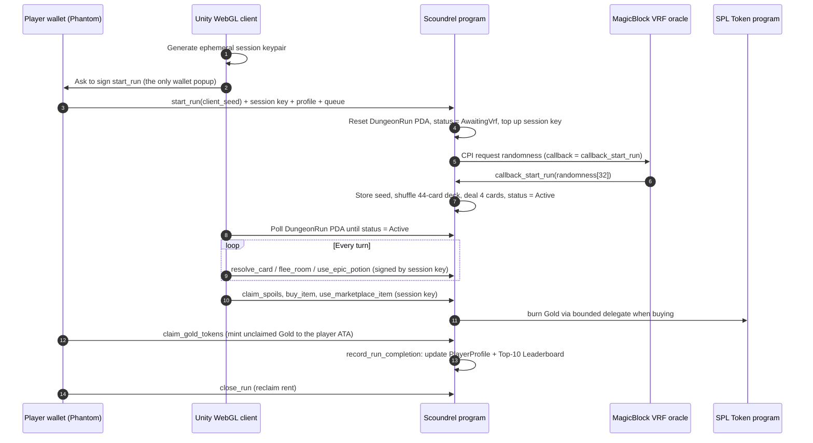

# ScOundreL: an on-chain Scoundrel roguelike on Solana

[](https://bobokan.itch.io/scoundrel)
[](https://explorer.solana.com/address/7r9dGYN2WiNKgr7wD89Heh4rrWX1zkGhxs8ckjKfbNQx?cluster=devnet)
[](https://docs.magicblock.gg/)
[](https://unity.com/)

ScOundreL is a single-player roguelike card crawler based on the solitaire game *Scoundrel*. The rules, the run state and the economy live in a Solana Anchor program on **Devnet**, and the game is played through a Unity 6 WebGL client.

## Play it now

**[ScOundreL by Bobokan on itch.io](https://bobokan.itch.io/scoundrel)** (desktop browser, Solana Devnet)

* Connect Phantom, Solflare or Backpack, or click **Devnet Burner** for an instant throwaway wallet.
* You need about 0.015 Devnet SOL (use the in-game burner or <https://faucet.solana.com>).
* Click **START ON-CHAIN VRF RUN**. Sign once, wait a couple of seconds for the oracle, then play.
* Open the wallet panel at any time to see your DungeonRun PDA, session key, verified VRF seed and Explorer links.

A demo video link will be added here when available.

## How the on-chain flow works



### Step by step

1. **`start_run`**: the player signs once. The program resets the player's `DungeonRun` PDA (seeds `["dungeon_run", player]`), registers the ephemeral session key, tops that key up to 0.01 SOL if needed, bumps the `PlayerProfile` counters and sends a randomness request to the MagicBlock VRF queue through a CPI. The run is `AwaitingVrf` until the oracle answers.
2. **`callback_start_run`**: the oracle node calls back with 32 random bytes. The program checks the caller is the VRF identity, writes the seed into the run, shuffles the 44-card deck and deals the first room of 4 cards. The deck order is a pure function of the stored seed, so anyone can recompute it from the account data.
3. **Turns**: `resolve_card`, `flee_room`, `use_epic_potion` and `use_marketplace_item` are signed by the session key, not the wallet, so there are no popups mid-run. The program rejects any signer that is not the session key stored in the `DungeonRun`.
4. **Gold**: monsters and spoils add to `unclaimed_gold` on the run. `claim_gold_tokens` mints that amount of SPL Gold to the player's associated token account from the program-owned mint PDA (`["scoundrel_gold_mint"]`, 0 decimals).
5. **Merchant**: `prepare_session_vault` creates the mint and ATA if needed and approves a bounded SPL delegate allowance (max 1,000 Gold) for the session key. `buy_item` then spends unclaimed run Gold first and burns SPL Gold from the player's ATA for any shortfall, without a wallet popup. Items: Ofe Charm (60), Rusty Shield (45), Epic Potion (75).
6. **Finish**: when a run ends in victory or defeat, `record_run_completion` updates the `PlayerProfile` PDA (`["profile", player]`) and inserts the run into the global `Leaderboard` PDA (`["leaderboard"]`), ordered by victory, then score, then remaining HP. Each entry keeps the first 8 bytes of the run's VRF seed. `close_run` returns the run account's rent.

### Where state lives

| Data | Location |
| :--- | :--- |
| Deck order, room, HP, weapon, potions, buffs, VRF seed, score | `DungeonRun` PDA (on-chain) |
| Lifetime runs, wins, defeats, best score, monsters slain, gold minted/spent, VRF requests | `PlayerProfile` PDA (on-chain) |
| Top-10 runs | `Leaderboard` PDA (on-chain) |
| Gold balance | SPL token account (on-chain) |
| Card art, animation, sound, UI | Unity client only |

There is no game server. The WebGL client only builds and sends transactions and reads accounts over Solana RPC. If Devnet or the wallet is unavailable the client falls back to a clearly labelled local simulation, which does not touch the chain.

## Core Solana features

* **MagicBlock VRF**: provably fair deck shuffle via `ephemeral-vrf-sdk` 0.17.3 and the default oracle queue.
* **Ephemeral session keys**: one signature to start a run, then popup-free turns authorised by the key registered on the run.
* **SPL Gold token**: program-owned mint PDA, mint to ATA on claim, burn through a bounded delegate when buying.
* **Persistent `PlayerProfile` PDA** and **global Top-10 `Leaderboard` PDA**.

## Devnet identifiers

| Component | Address |
| :--- | :--- |
| Program | [`7r9dGYN2WiNKgr7wD89Heh4rrWX1zkGhxs8ckjKfbNQx`](https://explorer.solana.com/address/7r9dGYN2WiNKgr7wD89Heh4rrWX1zkGhxs8ckjKfbNQx?cluster=devnet) |
| Gold mint PDA | [`aGiTr2glCPZwD3Avbvssx7UFyreDhC33YKvArG76CYg`](https://explorer.solana.com/address/aGiTr2glCPZwD3Avbvssx7UFyreDhC33YKvArG76CYg?cluster=devnet) |
| VRF oracle queue | [`Cuj97ggrhhidhbu39TijNVqE74xvKJ69gDervRUXAxGh`](https://explorer.solana.com/address/Cuj97ggrhhidhbu39TijNVqE74xvKJ69gDervRUXAxGh?cluster=devnet) |
| VRF program | [`Vrf1RNUjXmQGjmQrQLvJHs9SNkvDJEsRVFPkfSQUwGz`](https://explorer.solana.com/address/Vrf1RNUjXmQGjmQrQLvJHs9SNkvDJEsRVFPkfSQUwGz?cluster=devnet) |

The Profile, Leaderboard and DungeonRun addresses depend on the seeds above and, for the per-player ones, on your wallet. The in-game wallet panel shows yours.

## Verify a run yourself

1. Open the wallet panel and copy your **DungeonRun PDA** (or click **View on Explorer**).
2. On Solana Explorer (Devnet) you will see a `start_run` transaction from your wallet, followed by a `callback_start_run` transaction signed by the MagicBlock oracle node.
3. The 32-byte `vrf_seed` in the `DungeonRun` account is the oracle's randomness. The 44-card order is `shuffle_deck_from_vrf(seed)` in [`lib.rs`](anchor-program/programs/scoundrel/src/lib.rs).

## Game rules (this version)

* **Deck**: 44 cards. 26 monsters (two sets of ranks 2 to 14), 9 weapons (2 to 10) and 9 potions (2 to 10).
* **Room**: 4 cards at a time. Resolve cards, or flee the room (not twice in a row).
* **Monsters** deal damage equal to their rank. **Weapons** reduce damage and have a ceiling that drops as they kill. **Potions** heal (one per room benefits).
* **Start HP**: 20. You win by clearing the dungeon and lose at 0 HP.
* A legendary-weapon feature exists in code but is disabled for balance.

## Repository layout

```
anchor-program/     Anchor program (Rust), IDL, tests and devnet scripts
unity-client/       Unity 6 project (URP, WebGL, DOTween, Solana Unity SDK)
Scoundrel-WebGL-itch.zip   Latest WebGL build uploaded to itch.io
```

## Build it yourself

### Anchor program

Requires Rust, the Solana CLI and Anchor (the program uses `anchor-lang` 1.2.2).

```bash
cd anchor-program
anchor build
anchor test
```

### Unity WebGL client

1. Open `unity-client` in Unity **6000.0.64f1** with WebGL build support.
2. Use **Scoundrel > Build WebGL for itch.io**. This writes uncompressed `.wasm` and `.data` files (itch.io does not send the `Content-Encoding` header gzip builds need) and packages `Build/Scoundrel-WebGL-itch.zip`.

## Notes and limitations

* Devnet only. The public Devnet RPC is rate-limited and can time out, which can delay seeing the oracle result in the client.
* Compiled with `anchor-lang` 1.2.2 and `ephemeral-vrf-sdk` 0.17.3. The program has not been audited.
* The client's wallet adapter was tested with Phantom in desktop browsers.

## Hackathon

Built for the [MLH Solana Hackathon](https://events.mlh.com/events/15200-solana-hackathon). Developed with the Antigravity IDE and AI coding models.
